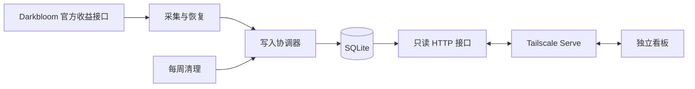

# Bloomer 设备端开发方案与实施计划

更新日期：2026-10-16  
状态：待实施；本文是开发方案，不代表程序或接口已经完成。

需求依据：[设备端开发目标](agent-development-goals.md)  
目录依据：[仓库结构](repository-structure.md)

## 1. 交付目标与范围

交付一个运行在 Darkbloom 所在 Mac 上的 `bloomer-agent` 后台程序，完成账户收益采集、本地存储、中断恢复、过期清理，以及供独立看板读取的私网接口。

首版交付物：

- macOS / Apple Silicon 可执行程序及版本信息。
- 不含真实凭证的配置示例。
- 版本化数据库迁移文件。
- `/v1` 查询接口与 OpenAPI 契约。
- LaunchAgent 配置、安装与停止说明、升级和数据库恢复说明。
- 覆盖关键数据边界的自动化测试及真实设备运行验证记录。

首版不包含看板界面，也不实现 Provider 控制、模型切换、实时日志订阅、系统资源历史及自动策略。Provider 状态与模型清单按后续只读扩展处理。

### 1.1 必须保持的采集与留存规则

| 规则 | 实现要求 |
| --- | --- |
| 正常周期 | 60 秒；启动时先安排一次采集 |
| 正常窗口 | 每轮重新从 50 条开始 |
| 扩窗 | 当前窗口去重、排除过期后，相对轮前数据库全部为新增，才执行下一档 |
| 扩窗阶梯 | 50 → 100 → 300 → 1000；达到上限结束，不无限请求 |
| 长中断恢复 | 距最近完整成功采集达到 30 分钟，本轮直接读取 1000 条 |
| 首次启动 | 无可信检查点时直接读取 1000 条 |
| 关闭记录 | 正常退出保存关闭时间；异常退出依靠持久化的成功检查点恢复 |
| 查询范围 | 滚动 365 天，按收益发生时间判断 |
| 物理删除 | 距上次成功清理满 7 天执行，错过后补做一次 |

不增加繁忙模式、动态默认窗口、定时额外读取 1000 条或单独的数量探测请求。错误重试和服务端限流等待保留。

## 2. 整体设计

采用单进程、单个采集协调器和本地 SQLite。官方请求串行执行；采集写入与过期清理由同一协调器安排；HTTP 查询可以并行。



### 2.1 模块与职责

| 模块 | 职责 | 边界 |
| --- | --- | --- |
| 配置 | 路径、监听地址、凭证文件、固定规则与超时配置 | 启动时校验，配置中不保存明文官方令牌 |
| 官方客户端 | 请求收益接口、认证、解码、错误分类 | 不负责写库或决定扩窗 |
| 采集器 | 选择窗口、合并响应、计算新增、识别疑似缺口 | 每轮只有一个实例运行 |
| 数据存储 | 查询轮前记录、事务提交、数据库迁移 | 提供明确的事务边界，无须 ORM |
| 清理器 | 删除过期明细、裁剪覆盖范围 | 只在采集轮次之间执行 |
| 查询接口 | 概览、明细、统计、健康与认证 | 只读数据库，不调用官方收益接口 |
| 服务生命周期 | 启动、调度、退出、单实例保护 | 统一管理取消和退出顺序 |
| 运行日志 | 脱敏错误和定期摘要、文件轮转 | 不复制整个接口响应 |

### 2.2 设备端代码目录

以下是实施时创建的目录，不是本次已经生成的代码：

```text
apps/agent/
├── cmd/bloomer-agent/main.go
├── internal/
│   ├── config/
│   ├── upstream/
│   ├── collector/
│   ├── store/
│   ├── retention/
│   ├── httpapi/
│   ├── service/
│   └── logging/
├── migrations/
├── testdata/                   # 脱敏或合成接口样本
├── packaging/macos/            # LaunchAgent 与配置示例
├── go.mod
└── go.sum
```

共享接口文件位于仓库根目录的 `contracts/openapi.yaml`，设备端不依赖看板的构建工具。优先使用 Go 标准库及 `modernc.org/sqlite`；实现开始时锁定兼容版本，不在文档中猜测最新版本号。

## 3. 配置、运行目录与进程

### 3.1 默认配置

| 配置 | 默认值 / 约定 |
| --- | --- |
| HTTP 监听 | `127.0.0.1:17890`，端口可配置 |
| 官方接口 | `https://api.darkbloom.dev/v1/provider/account-earnings`，实现前复验 |
| 官方凭证 | 从运行 Darkbloom 的用户的凭证文件读取 |
| 看板访问凭证 | 独立的本地访问令牌文件，不复用官方令牌 |
| 正常周期 / 恢复阈值 | 60 秒 / 1800 秒 |
| 保留期 / 清理间隔 | 365 天 / 7 天 |
| 官方请求超时 | 建议 10 秒；单轮总预算建议 50 秒，包含请求与最终提交 |
| HTTP 查询超时 | 建议 10 秒；取消请求时同步取消数据库查询 |
| 数据过期提示 | 距最近成功采集超过 120 秒时标记 `data_stale`，与 30 分钟恢复阈值区分 |

时间预算属于实现初值，应通过目标设备验证后调整；不能因此改变用户确认的正常窗口与恢复规则。

配置采用 JSON，避免为了少量字段再引入解析依赖。路径通过用户目录 API 解析，不能依赖 LaunchAgent 的 shell 环境展开 `~`。凭证读取与轮转时不把内容写入日志；拒绝将官方认证头转发给其他源的重定向。

### 3.2 运行文件

| 文件 | 建议位置 |
| --- | --- |
| 程序与版本目录 | `~/Library/Application Support/Bloomer/agent/bin/` |
| 配置、访问令牌、数据库与维护文件 | `~/Library/Application Support/Bloomer/agent/` |
| 应用日志 | `~/Library/Logs/Bloomer/agent/` |
| 后台任务 | `~/Library/LaunchAgents/` 下的专用 plist |

运行数据位于仓库之外。私有目录和令牌分别采用仅当前用户可访问的目录、文件权限。单实例保护使用操作系统文件锁，不能仅凭遗留 PID 文件判断进程是否存在。

LaunchAgent 使用绝对路径和运行 Darkbloom 的同一用户。它在用户登录后工作，不承诺无人登录或设备休眠时仍能采集。

## 4. 数据模型与一致性

### 4.1 首版逻辑表

| 表 | 主要内容 | 写入 / 保留方式 |
| --- | --- | --- |
| `earnings` | 账户 ID、记录 ID、Provider 标识及 Key、任务 ID、模型、微美元金额、输入输出 Token、发生时间 | 唯一键为 `(account_id, record_id)`；365 天查询，每周删除 |
| `account_summary_current` | 官方累计记录数、累计收益、余额、可提现余额、观察时间 | 每账户一行，成功轮更新最新有效快照，不每分钟追加历史行 |
| `sync_state` | 最近尝试、最近完整成功、错误、模式、历史覆盖起点及状态 | 每账户一行；成功检查点与收益同事务提交 |
| `coverage_gaps` | 疑似缺口的发现时间、采集中断区间、原因 | 相邻持续事件合并；已过期区间在周清理时裁剪或删除 |
| `maintenance_state` | 关闭时间、启动记录、清理成功时间、明确限流截止时间 | 单行维护状态；关闭时间不替代成功检查点 |

数据库 schema 使用迁移版本记录管理，不能通过“发现缺列便临时补列”的方式维护。

首版保留最新账户快照；历史收益分析由收益明细提供。需要余额历史曲线时，再单独定义采样粒度和保留期，不默认无限保存快照。

### 4.2 字段与索引

- 金额保存为整数微美元，不能经过 `float64` 换算。允许源数据表达调整金额，不能擅自过滤合法负值。
- 时间保存为 UTC 整数微秒，保留已知接口精度；对外使用明确的 UTC 时间字符串。
- 记录 ID 当作稳定标识处理，避免 JSON 解码为浮点数；首版可存为文本，不假设 ID 连续。
- 缺失必填字段与数值 0 分开处理。没有真实模型、金额或时间时不能编造默认值继续入账。
- 账户标识必须一致；检测到凭证返回了另一个账户时，不得把新账户余额写入原账户状态。
- Provider 标识先保存官方原值，不能直接声称它等同于物理设备 ID。

建议建立：

1. 唯一索引 `(account_id, record_id)`。
2. 查询索引 `(account_id, created_at_us DESC, record_id DESC)`。
3. 模型查询索引 `(account_id, model, created_at_us DESC, record_id DESC)`。

首版为单设备单账户工作模式。先保持表结构清晰；只有最终容量测量说明收益明显时，再把重复的账户、模型和 Provider 文本拆为编号关联表，不能将先前合成数据容量直接当成当前 schema 的保证。

### 4.3 SQLite 使用方式

- WAL 模式；写入连接限制为 1，查询连接池建议最多 2 个，分别设置忙等待与查询超时。
- 连接级配置需要对每个新连接生效，包括 `foreign_keys`、`busy_timeout` 等；同步策略以数据可靠性优先，初始采用 `FULL`。
- 正常采用 SQLite 的 checkpoint 机制，不在每条写入后强制清空 WAL。
- 采集与清理都通过写入协调器执行；网络请求期间不保持数据库事务。
- HTTP 查询及时关闭结果集，避免长时间读事务阻碍 WAL 回收。

### 4.4 单轮提交

所有必要请求和数据校验完成后，用一个短事务完成：

```text
开始事务
  → 插入新增明细 / 更新字段确有变化的明细
  → 更新最新账户快照
  → 更新覆盖信息及本轮发现的疑似缺口
  → 更新 last_successful_sync_at 和成功状态
提交事务
```

事务失败则全部回滚。扩窗过程中任意请求失败时，丢弃本轮尚未提交的缓冲；不推进成功检查点。失败健康信息可通过单独的小写入更新，但不得伪装成采集成功。

## 5. 采集、调度与恢复算法

### 5.1 单轮流程

1. 等待本轮执行条件满足，同时遵守持久化的限流截止时间。
2. 固定 `round_started_at` 和 `retention_cutoff = round_started_at - 365 天`。
3. 根据最后完整成功时间选择起始窗口：无可信检查点或中断达到 30 分钟时为 1000，否则为 50。
4. 请求当前窗口；校验 HTTP 状态、响应结构、账户及关键字段。
5. 对当前响应内部按 ID 去重，并排除早于本轮保留期起点的记录。
6. 查询这些 ID 在本轮开始前的数据库中是否存在，计算本窗口新增条数。
7. 把有效记录合并到本轮缓冲，已有记录的有效修正也保留；跨响应同 ID 使用后一次有效响应的数据。
8. 若本窗口新增数等于请求上限且仍有下一档，继续扩窗；否则结束请求阶段。
9. 识别首次导入或疑似缺口，执行单轮事务提交。
10. 回到正常调度，下一轮不继承本轮窗口大小。

响应内部重复 ID 若字段相同则折叠；若同一响应对同一 ID 给出冲突数据，作为上游异常处理，不能随机选取一份并声明成功。

### 5.2 固定轮前比较基准

扩窗期间不写入收益表，也不执行物理清理。因此即使 50 条先进入内存，后续 100 条中包含这 50 条，它们仍属于相对轮前数据库的新记录。

需要判断的是**当前响应窗口内的新增数**，不是“本轮累计新增数”，也不是“相对于前一次 HTTP 响应多出来的条数”。

单次响应最多 1000 条；普通完整扩窗路径合计最多读取 `50 + 100 + 300 + 1000 = 1450` 条次。上游记录在请求之间增长时，各响应合并后的不同 ID 可能超过 1000，不能把缓冲强行截成 1000 条。客户端需要校验响应数量与配置的响应体大小上限，避免无界缓冲。

### 5.3 周期与错误处理

- 服务启动后立即安排一次采集，此后按 60 秒计划运行。
- 只有一个采集轮次；长请求或休眠导致错过多个周期时，恢复后只安排一轮，不突发补发所有错过的任务。
- 每轮实际开始前重新计算最近成功间隔；调度不能只依赖一个可能跨休眠失效的内存计数器。
- 一般网络或服务端失败留待后续周期重试，不在同一轮无限重试。
- 429 的 `Retry-After` 优先于正常 tick；重启服务也不能绕过已知的限流截止时间。
- 401 / 403 作为认证错误呈现；保留旧数据，后续周期检查凭证是否恢复，不在一轮内反复认证。
- 配置错误、无法打开数据库或不支持的 schema 在启动时明确失败；运行期间写库失败则报告降级，不能返回伪造的空收益。

### 5.4 恢复与覆盖状态

正常退出写入 `last_clean_shutdown_at`；每轮成功事务写入 `last_successful_sync_at`。启动和断网、休眠恢复时，以成功检查点判断是否达到 1800 秒，关闭时间用于辅助解释中断原因。

例如关闭前已采集失败 25 分钟，再关闭 10 分钟，应按至少 35 分钟中断请求 1000 条。检查点在未来、明显时钟回拨或时间不可信时，采用恢复读取。

首次导入只记录可见历史起点，不将“1000 条都是新记录”误报为本产品运行期间的缺口。已有历史后，窗口饱和或恢复结果无法与既有历史建立覆盖关系时，记录疑似缺口；该区间表示观测中断，不能声称是精确丢失收益的时间边界。

接口只有最近 1000 条时，不能保证补回窗口之外的遗漏或修正。之后同步成功不能自动抹去仍在保留范围内的疑似缺口。

## 6. 一年保留与每周清理

### 6.1 查询过滤

每次查询固定一次当前时间，所有明细与聚合共用 `created_at >= now - 365 天`。相等边界保留。查询更早历史时返回明确的可用起点和范围信息，不静默展示超期数据。

账户官方累计收益不受本地留存截断，必须与最近一年本地明细合计分别返回。

### 6.2 清理任务

1. 首次启用维护状态时执行一次清理检查，成功后建立清理时间。
2. 之后距上次成功清理满 7 天时安排任务；启动发现到期时补做一次。
3. 冻结本次清理截止时间，在轮次之间按批删除 `created_at < cutoff` 的记录；建议初始每批 1000 条。
4. 每批采用短事务，批次之间允许正常采集优先执行；采集正在进行时不删除记录。
5. 全部批次完成后，更新历史起点、裁剪已过期的疑似缺口，再记录清理成功时间。
6. 中途失败保留已完成删除，不更新成功时间；后续调度继续清理，避免反复启动无间隔重试。

过期记录如果再次从官方返回，在计算新增之前过滤，不重新入库。删除不等于文件立即缩小；首版不在每周任务里执行全库 `VACUUM`。清理查询、长读事务和 WAL 大小需要纳入运行验证。

物理数据可能在周清理前短暂超过 365 天；接口始终只提供最近 365 天。日志和维护事件按各自策略限制增长，不默认无限追加。

## 7. 查询接口方案

以下为拟定路径，实施时写入 `contracts/openapi.yaml`；本文不创建尚未实现的契约文件。

| 接口 | 内容 |
| --- | --- |
| `GET /v1/health` | 进程版本、采集状态、最后成功时间、数据过期、最近错误和清理状态 |
| `GET /v1/account/overview` | 当前账户官方累计与余额、本地一年合计、记录数及覆盖信息 |
| `GET /v1/earnings` | 时间范围、模型筛选、稳定游标分页 |
| `GET /v1/earnings/stats` | 按小时、天、月或模型统计，明确时区与范围 |

首版服务一个配置账户，不实现官方设备发现或账户管理接口。

### 7.1 查询与响应约定

- 明细分页默认 100 条、上限 500 条，排序为 `(created_at_us DESC, record_id DESC)`。
- 游标包含版本、固定查询时间范围、筛选条件及上一条排序键；客户端不能混用不同条件的游标。
- 翻页时保留固定结束时间、筛选条件和排序键，有效开始时间取 `max(原开始时间, 当前保留期起点)`；范围收窄时返回标记。不能仅因几秒流逝让默认一年范围的下一页立即失效。整个游标时间范围已过期时才要求重新查询；排序键已早于有效起点、没有剩余可见记录时正常结束分页。
- 并发采集期间分页不承诺跨请求的数据库快照；新到的较新记录在刷新后展示，同一排序键的稳定排序应保证普通翻页不重复。
- 时间范围为 `[from, to)`。输入超出保留期时返回可用范围说明；缺省范围为当前最近 365 天。
- ID 保留来源标识的文本形式，不限定只能是十进制数字；微美元金额使用十进制整数字符串传输，避免看板 JavaScript 数字精度损失，数据库金额仍为整数。
- 所有需要数据库数据的响应提供 `last_successful_sync_at`、保留期起点和覆盖状态；进程在线不代表数据新鲜。
- 统计接受 IANA 时区名称；本地日期分组正确处理夏令时，不能把任意时区的一天固定视为 24 小时。统计以流式或受限批次读取必要列，避免将一年全部明细加载进内存。
- 部分覆盖或疑似缺口通过元数据说明，不能把未观测区间直接解释为官方收益为零。

### 7.2 访问与错误

接口只监听回环地址，经 Tailscale Serve 暴露；所有数据接口使用独立 Bearer 访问令牌。拒绝未配置的跨域访问；若后续采用浏览器看板，再按实际来源配置 CORS。

错误采用统一结构：`code`、可读 `message` 和用于排错的请求标识，不包含凭证及内部 SQL。建议区分参数错误、未授权、数据尚不可用、数据库不可用和请求超时。

设备端官方接口失败时，本地可用查询仍可返回缓存及过期标识；数据库本身不可用时明确报错，不能将失败转换成 0 收益。

## 8. 启停、迁移与发布

### 8.1 启动与退出

启动顺序：读取配置与路径 → 获取单实例锁 → 打开数据库并检查迁移 → 恢复检查点与限流状态 → 开放查询 → 启动采集及维护调度。

正常退出顺序：停止接受新的采集和清理任务 → 在有限时间内结束或取消在途操作 → 等待已进入提交阶段的写入结束并确认结果 → 保存关闭时间 → 关闭接口和数据库 → 释放锁。通过信号处理支持终端停止和 launchd 停止；不能依赖强制终止执行退出回调。

数据库提交若被取消，必须保持回滚语义；关闭时间保存失败时输出明确日志，下一次仍依赖最后成功检查点恢复。

### 8.2 迁移与恢复

- SQL 迁移按版本嵌入程序，迁移完成与 schema 版本推进在同一事务中。
- 已有数据库升级前建立一致性备份；不能在服务写入时只复制 `.db` 主文件。
- 采用 SQLite Backup API 或 `VACUUM INTO` 生成一致副本，具体方式在数据库模块阶段验证。
- 迁移失败保留可恢复数据并停止启动；发现数据库版本高于程序支持版本时拒绝自行降级。
- 数据库恢复必须先停服务，不把旧 WAL / SHM 与恢复后的数据库混用。
- 迁移备份属于升级保障，不增加默认的周期备份需求。成功验收后按维护说明处理临时备份；长期备份周期与保留策略如有需要另定。

### 8.3 打包与安装

- 发布构建目标为 `darwin/arm64`，采用不依赖 CGo 的正式构建，记录版本与提交号。
- 提供配置示例、LaunchAgent 模板和安装/升级脚本；模板在安装时生成当前用户的绝对路径。
- 安装前检查端口、目录权限、Darkbloom 凭证可读性和 Tailscale 接入条件，不修改 Provider 的启停状态。
- 软件升级替换程序和对应配置，保留数据库与私有令牌；程序回退需满足数据库版本兼容要求。
- 停止常驻服务使用 launchd 管理命令；不能把“杀进程后被自动拉起”误解为已经停止服务。

## 9. 分阶段实施计划

按阶段推进，不给未经原型验证的日历工期。每个阶段达到完成条件后进入依赖它的下一阶段。

| 阶段 | 工作项 | 交付物 | 完成条件 |
| --- | --- | --- | --- |
| P0：契约和环境 | 检查 Go 构建环境；复验实际接口字段、上限和错误结构；整理脱敏样本；确认时间和金额解析 | 样本、错误分类、初版 OpenAPI 草案、版本锁定记录 | 样本覆盖正常、重复、异常；未验证能力明确标注，不新增假设参数 |
| P1：工程与数据库 | 建立 Agent 目录、配置、日志、迁移、表和必要索引；建立运行数据排除规则 | 可启动的本地骨架、临时数据库测试、配置示例 | 无需官方网络即可启动；迁移可回滚；单实例和路径有效 |
| P2：正常采集 | 官方客户端、60 秒调度、50 条窗口、单轮扩窗、缓冲与原子提交 | 可对模拟服务运行的完整采集器 | 扩窗基准正确；重复不累加；请求或提交失败不推进成功时间 |
| P3：恢复与留存 | 30 分钟判断、关闭时间、限流等待、疑似缺口、365 天过滤及每周清理 | 恢复和维护逻辑 | 时钟/休眠/崩溃边界正确；错过任务可补做；过期记录不重新导入 |
| P4：查询接口 | 认证、概览、明细游标、按时区统计、健康和错误响应 | `/v1` 接口、定稿 OpenAPI | 不依赖看板即可验证；所有历史查询应用保留期；金额和口径准确 |
| P5：后台交付 | 正式构建、LaunchAgent、安装升级及恢复说明 | 可安装包、操作文档 | 在目标 Mac 登录后运行；正常停止记录时间；升级保留数据 |
| P6：联调验收 | 真实只读采集、故障恢复、清理、并发查询和资源测量 | 验收报告、已知限制、可发布版本 | 全部关键场景通过；数据可核对；资源数据来自实测 |

依赖关系：`P0 → P1 → P2 → P3 → P4 → P5 → P6`。接口样本和 OpenAPI 在 P0 开始，随实现更新；只有在查询与采集核心稳定后，才与实际看板联调。

## 10. 验证方案

### 10.1 自动化验证

优先用 Go 标准库的模拟 HTTP 服务、可控制时间源和真实临时 SQLite。测试数据不能包含真实凭证。重点测试持久化和失败边界，不为简单字段访问编写重复测试。

| 分类 | 必须覆盖的场景 |
| --- | --- |
| 扩窗 | 50 全新后 100 仍全新继续；100 中 70 新即停止；下一轮恢复 50 |
| 去重与修正 | 响应内部重复、不同账户同 ID、已有记录金额修正、过期记录重现 |
| 移动窗口 | 扩窗之间加入新记录，合并缓冲可以超过 1000，不静默丢弃较早响应 |
| 失败事务 | 第 2 次请求失败、畸形 JSON、必填字段缺失、整数溢出、提交失败，成功检查点均不前移 |
| 恢复 | 29 分 59 秒与恰好 30 分钟；关闭前失败 25 分钟再停机 10 分钟；无关闭回调；时钟回拨 |
| 调度 | 单轮跨周期、模拟休眠、429 跨多个 tick；均不并发、不积压、不绕过限流 |
| 保留与清理 | 365 天相等边界保留；查询与统计同时过滤；删除中断重试；停机错过多周只补做一次 |
| 读写协调 | 采集和清理同时到期不改变轮前基准；长查询取消后释放结果集 |
| 分页与统计 | 相同发生时间的多条记录稳定翻页；默认一年范围在时间推进后仍可继续翻页；筛选条件错配游标被拒绝；夏令时分组和部分覆盖提示 |
| 生命周期 | 正常停止记录关闭时间；异常停止后检查点可恢复；重复启动不能争用同一数据库 |
| 迁移与恢复 | 旧版本升级、故意失败回滚、高版本拒绝、备份恢复后数据与检查点一致 |

常规检查在 `apps/agent` 执行 `go vet ./...`、`go test ./...`；支持的开发环境补充 `go test -race ./...`。正式无 CGo 构建与 race 检查分别执行，不混用构建条件。

### 10.2 真实设备验证

在模拟验证通过后，在目标 Mac 做只读采集联调。核对相同采集时点的账户汇总和可见明细，避免不同请求时点的数据变化造成误判。采集验证不执行 Darkbloom 启停、重启或切换模型。

建议至少跨过一个完整日周期运行，记录：实际请求数、扩窗次数、错误、重复与新增数量、数据量、常驻内存、CPU、网络流量、数据库和 WAL 大小。每周清理使用可控时间和过期样本验证，无须等待真实一周。

休眠、断网和强制终止等影响真实设备的验证，先在测试环境完成；在实际接单设备上安排时遵循其运行约束，不能为了验证采集器打断现有业务。

### 10.3 资源与完成判定

之前的程序体积与内存范围只作预算参考：发布包暂按 15～35 MB、常驻内存暂按 30～100 MB、正常采集平均 CPU 低于单核 1% 作为验证目标。记录测量方法和负载，查询、导入及维护峰值单列；超出后说明原因并优化，不能把估算当作通过证据。

数据库使用最终 schema 生成代表性一年样本，例如每天 5000 条共约 182.5 万条，测量主库、索引、WAL、查询耗时和维护空间。内存验证确认查询不随一年明细总数无界增长。

首版完成需同时满足：用户规则对应测试通过、实际数据口径核对通过、后台启动与恢复有效、接口契约一致、没有凭证或运行数据库进入 Git，并有资源与已知限制记录。

## 11. 实施前需要复验的事项

以下属于开发任务，不要求在编写本文时操作真实设备或安装依赖：

1. 实际部署版本的收益接口字段、最大条数、错误与限流约束。
2. 账户汇总与明细是否同一快照、记录排序和修正语义；未知时继续保留覆盖不确定性。
3. Go、驱动和目标 macOS 的兼容组合及最终构建体积。
4. 目标用户的 Darkbloom 凭证位置、LaunchAgent 环境及 Tailscale Serve 代理可用性。
5. 最终 schema 的容量；是否有必要为重复标识增加维表。

本文不引入新的产品选择，不改变已确认的 60 秒 / 50 条、30 分钟恢复与一年留存规则。新发现若影响这些约束，应先更新目标文档，再同步实施方案。

## 参考

- [设备端开发目标](agent-development-goals.md)
- [仓库结构](repository-structure.md)
- [Go database/sql](https://pkg.go.dev/database/sql)
- [modernc.org/sqlite](https://pkg.go.dev/modernc.org/sqlite)
- [SQLite WAL](https://www.sqlite.org/wal.html)
- [SQLite 一致性备份](https://www.sqlite.org/backup.html)
- [SQLite PRAGMA](https://www.sqlite.org/pragma.html)
- [Go 信号处理](https://pkg.go.dev/os/signal)
- [Tailscale Serve](https://tailscale.com/docs/reference/tailscale-cli/serve)
